

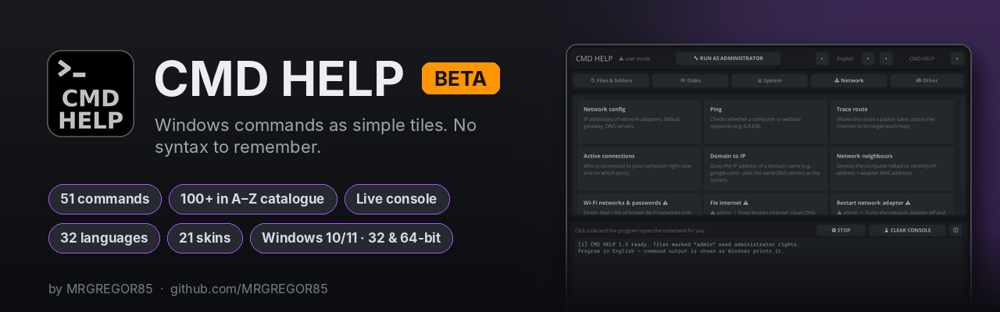

  

### Windows commands as simple tiles.
Pick a topic, click a tile, and CMD HELP runs the command and shows the result. No typing, nothing to remember.

 

Windows 10 and 11 · 32-bit and 64-bit · one file, nothing to install

  

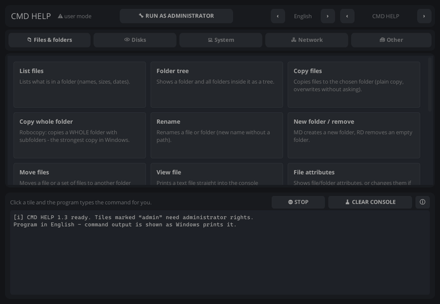

 

## What it does

| Feature | What it means |
|---|---|
| **51 command tiles** | Files & folders, Disks, System, Network, Other. One click instead of remembering commands. |
| **A–Z catalogue** | About 100 Windows commands, each with a short description. |
| **Your own command** | Type any command yourself when you need it. |
| **Live result** | The answer appears as the command runs. **STOP** cancels it. |
| **Asks before anything risky** | Delete, close a program, shut down: you see the full command and click **YES** or **NO**. |
| **Administrator in one click** | Tiles that need it are marked **admin**. |
| **Your style** | 32 languages and 21 colour themes. |
| **Private** | No ads, no tracking, no account. |

## Screenshots

<table>
<tr>
<td width="50%">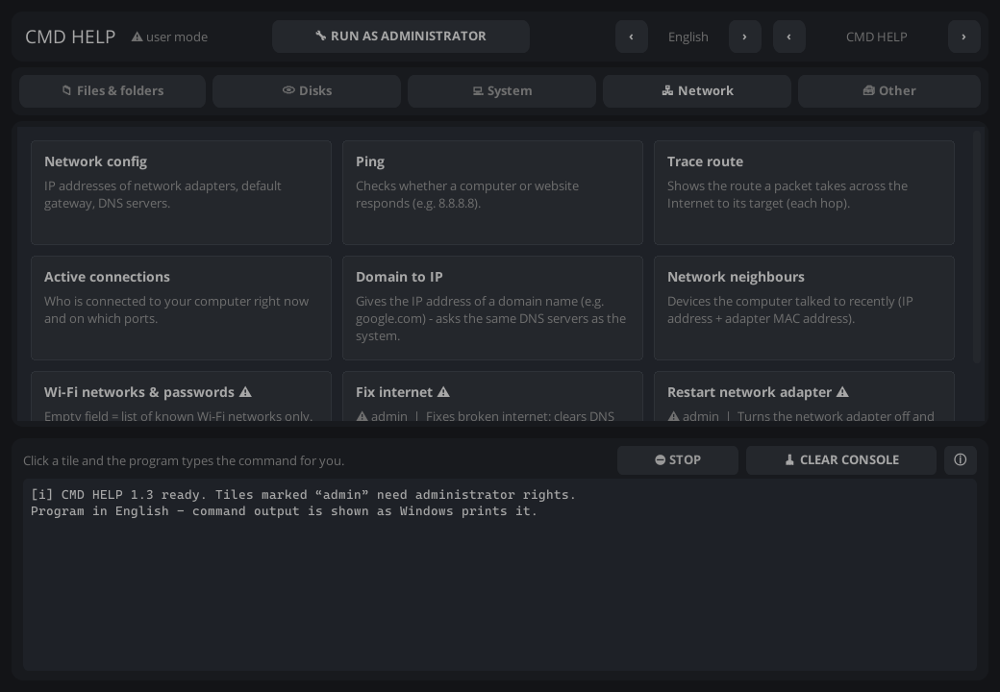</td>
<td width="50%">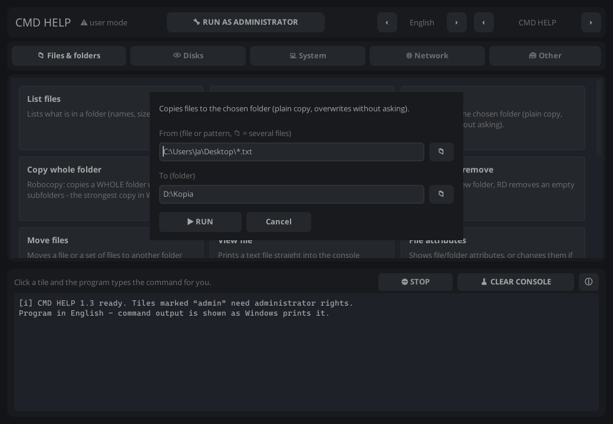</td>
</tr>
<tr>
<td align="center"><b>Network tiles</b></td>
<td align="center"><b>A command window</b></td>
</tr>
<tr>
<td>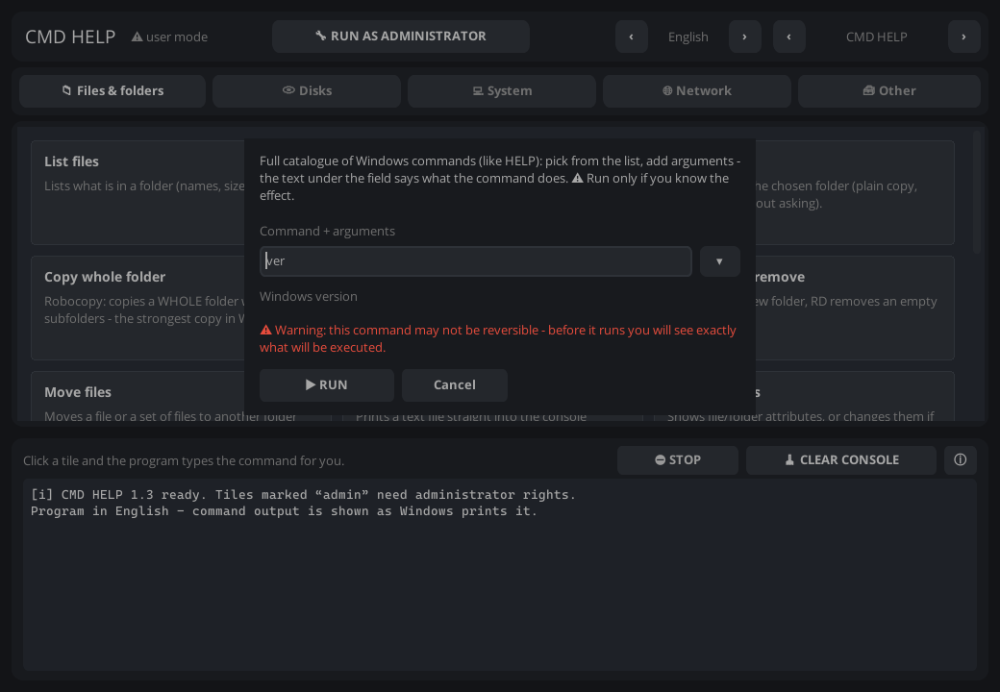</td>
<td>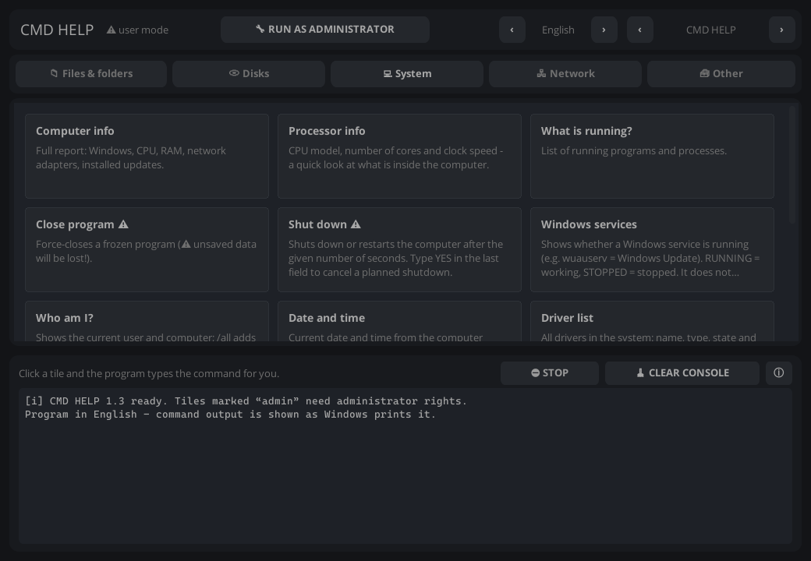</td>
</tr>
<tr>
<td align="center"><b>A–Z catalogue</b></td>
<td align="center"><b>System tiles</b></td>
</tr>
</table>

<b>See all 21 colour themes</b>

 
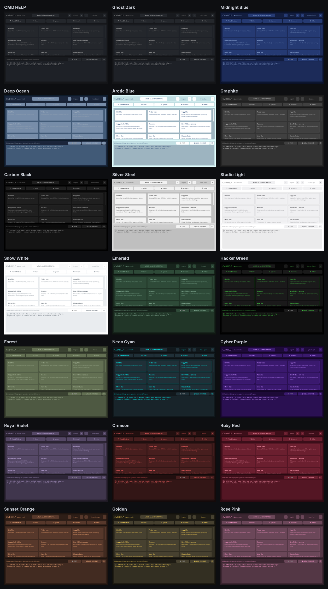

## 📖 How to use it, step by step

🟥 A red frame shows **where to click**. 🔴 Numbers **1**, **2** show **what to click first**.

### 📥 Step 1. Download

Click the green **Download** button at the top of this page. Your browser downloads one file: **CMD-HELP.exe**.

### 📂 Step 2. Open the downloaded file

- Click the downloaded file in the **top right corner** of your browser,
- or open the **Downloads** folder and double-click **CMD-HELP.exe**.

> 💡 **Tip:** drag the file from *Downloads* onto your **Desktop**. Next time you will find it straight away.

### 🛡️ Step 3. A blue window? That's fine

The first time, Windows may show a blue window: *"Windows protected your PC"*.
This is normal for small, free programs.

1. Click **More info**.
2. Click **Run anyway**.

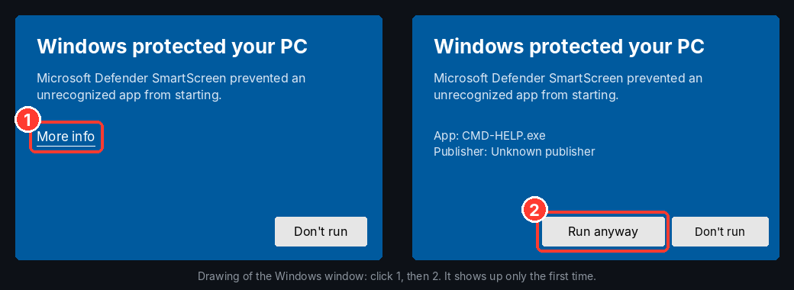

This window appears **only once**. ✅ The program is running!

## 🖱️ Using the program

### 🗂️ Step 4. Pick a topic at the top

The commands are split into 5 topics: **Files & folders**, **Disks**, **System**, **Network** and **Other**.
Click a topic and its tiles appear below.

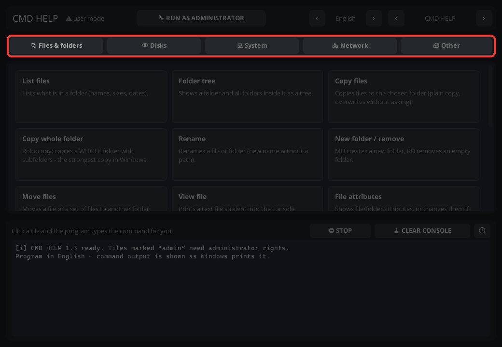

### 🖱️ Step 5. Click a tile

One tile is one thing your computer can do. Under its name there is a **short, plain description**.
For example: the **Network** topic (1), then the **Ping** tile (2). Ping checks whether the internet works.

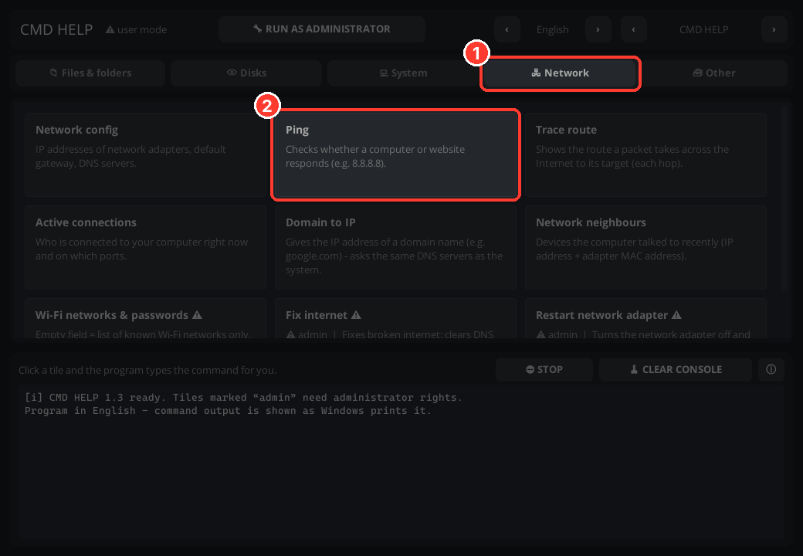

> 💡 There are more tiles than you can see. Scroll down with the mouse wheel.

### ⌨️ Step 6. Type what is needed and click RUN

Some tiles ask for something, for example a website address or a folder.
The field already holds a **ready example**, so you can click straight away.

1. The field to type in (for folders there is also a 📁 button to pick one with the mouse).
2. Click **▶ RUN**.

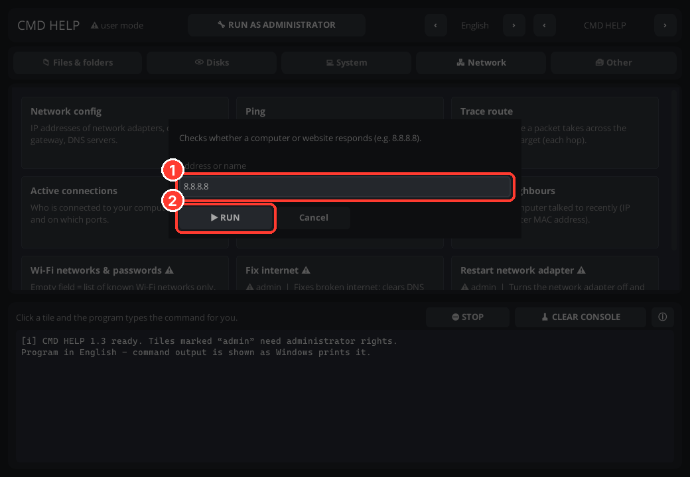

### 📺 Step 7. Read the result at the bottom

The result appears in the **black area at the bottom** (the console).

1. Here is the result.
2. Taking too long? Click **STOP**.

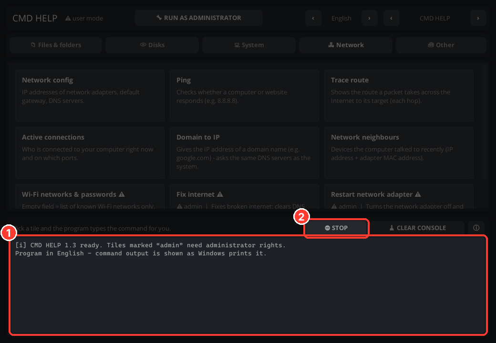

> 🧹 **CLEAR CONSOLE** empties the black area.

### ⚠️ Step 8. Tiles with ⚠ ask before doing anything

Tiles with the **⚠** triangle can change something on your computer (for example close a program or shut the computer down).
That is why the program **always asks first**:

1. **YES** = do it.
2. **NO** = do nothing.

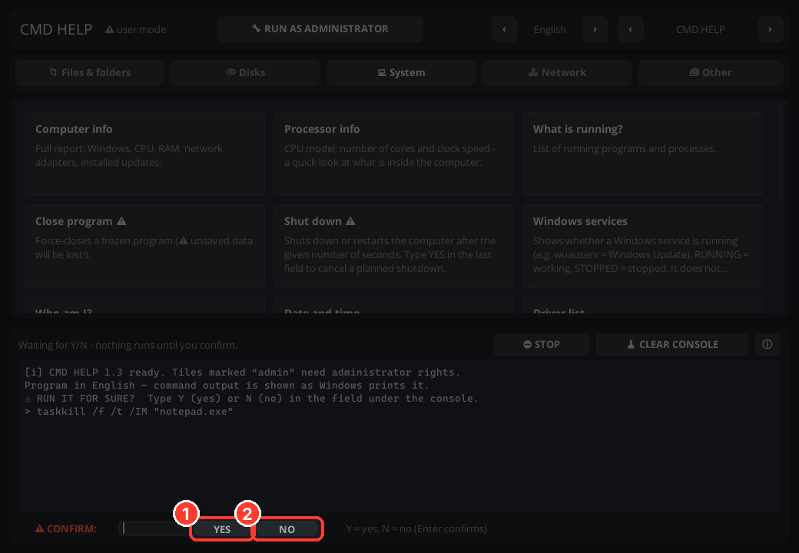

> 🛡️ Nothing happens until you click **YES**. Don't be afraid to click around.

### 📚 Step 9. Want more? The "Other" topic

1. **All commands A-Z**: the full list of Windows commands. Each one says what it does.
2. **Custom command**: type any command yourself (for people who know the console).

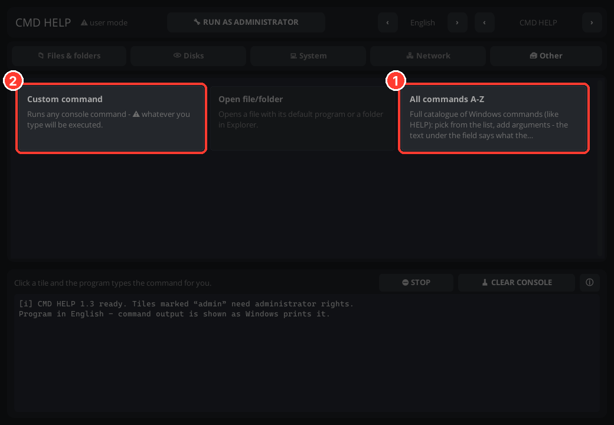

### ✅ Step 10. Done

Close the program with the usual **X** in the corner. It remembers your language and colours.

## ✨ Extras

### 🌍 Language and 🎨 colours

At the top right there are two pairs of arrows **‹ ›**:

1. **Language:** 32 languages. Click the arrows until you see yours.
2. **Colours (skin):** 21 looks. Click until you like it.

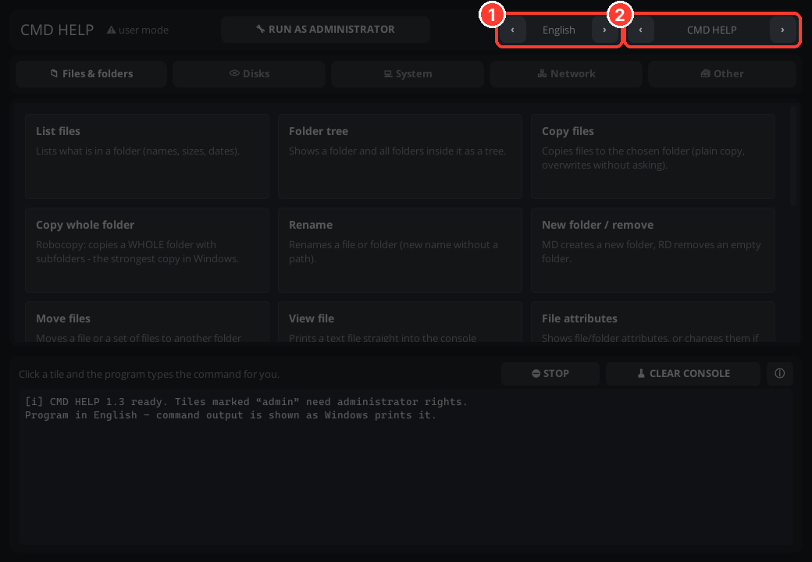

### 🔑 "Access is denied"

Some things only the computer's **administrator** may do. Those tiles are marked **admin**.

1. Click **RUN AS ADMINISTRATOR** at the top.
2. Windows asks whether to allow it. Click **Yes**.

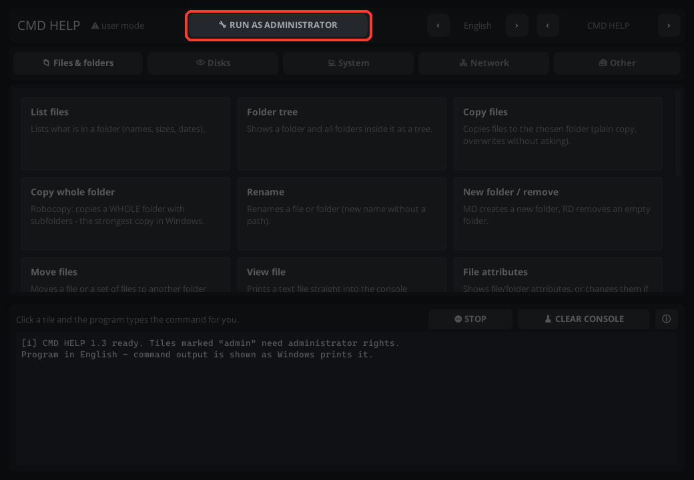

The program starts again, now with the rights it needs. At the top you will see **administrator mode**.

### ⓘ About the program

The round **ⓘ** button at the bottom right shows who made the program and its licence.

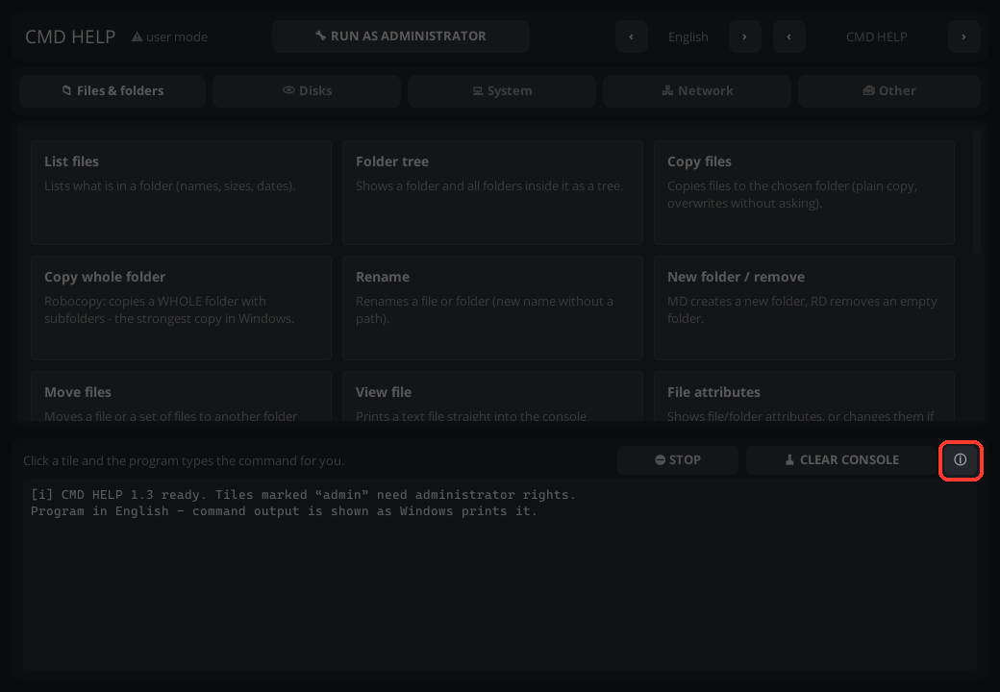

## 🆘 Something is not working?

| What I see | What to do |
|---|---|
| Blue window *"Windows protected your PC"* | **More info** → **Run anyway**. See Step 3 above. |
| The browser says the file *"isn't commonly downloaded"* | Click **⋯** next to the file → **Keep** → **Show more** → **Keep anyway**. |
| My antivirus warns me | This is common for small programs without a paid signature. The program only runs the Windows commands you click. |
| **"Access is denied"** | Click **RUN AS ADMINISTRATOR**. See "Access is denied" above. |
| It takes a while to start | It unpacks itself for a few seconds first. That is normal. |
| I want the settings back to new | Close the program. Type `%APPDATA%` in the folder address bar and delete the **CMD HELP** folder. |

Still stuck? Write on GitHub: [github.com/MRGREGOR85](https://github.com/MRGREGOR85)

## Is it safe?

CMD HELP only runs normal Windows commands. Anything that deletes, closes or shuts down shows the full command first and waits for your **YES**. Nothing runs in the background.

## License

Free for private and noncommercial use. Selling or commercial use only with the author's permission.
Full text: [PolyForm Noncommercial 1.0.0](LICENSE).

## 🎬 YouTube

<a href="https://youtu.be/xjmLeH1Z9j4">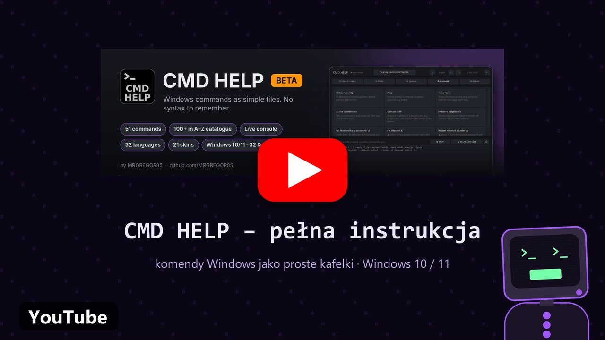</a>

**▶ [Full video guide on YouTube](https://youtu.be/xjmLeH1Z9j4)**

## Author

**MRGREGOR85** · [github.com/MRGREGOR85](https://github.com/MRGREGOR85)

Also by the author: [**WG Installing**](https://github.com/MRGREGOR85/WG-INSTALLING-BETA), install and update Windows programs in one click.

If CMD HELP helps you, please give it a ⭐
